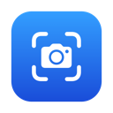

<p align="center">
  
</p>

<h1 align="center">Snapkeep</h1>

<p align="center">
  A menu bar screenshot app for macOS that keeps your screenshots on screen, on the clipboard and on disk.
</p>

---

Press Return to copy a screenshot and get on with your work. Click **Capture** instead and it's
also saved to `~/Pictures/Screenshots` and opened in a floating preview that stays until you close
it. In the preview you can select text straight from the image (Live Text) and draw on it.

## Features

- **Copied and saved automatically.** Paste right after you capture. Each file is named
  `screenshot-YYYY-MM-DD_HH-mm-ss.png`.
- **Previews that stay.** Each capture opens a floating window that never closes on a timer.
  Several can be open at once.
- **Select text in the image.** Live Text is ready as soon as the preview opens. Copy part of the
  text, or all of it with Copy Text.
- **Text-only capture.** One shortcut copies the text in an area and skips the preview. Select
  Text lets you pick parts of it on the spot, one after another, without closing.
- **Copy & Close.** Return copies an area straight to the clipboard, with no preview and no file.
- **Screen recording.** Record an area or a window, trim the start or the end, then save it as an
  MP4 video, a small GIF, or both.
- **Your own shortcuts.** Change any of the shortcuts in Settings.
- **Quick drawing.** Pen, highlighter, line, arrow, rectangle and text are always on the toolbar,
  in four thicknesses, no editor to open. Grab a drawing to move it, reshape it, recolour it or
  delete it. Copy and Save include the drawings at full resolution.
- **Snapping selection.** The screen freezes while you select, and edges snap to windows and to
  the lines between panes.
- **Just the page in browsers.** Optional. Hover a page in Zen, Chrome, Safari, Arc or another
  browser to pick the page without the tabs, toolbar or sidebar. Hover the browser's own bars to
  pick the whole window.
- **Your own buttons.** Add buttons to the preview that run a command with the screenshot, or
  send it straight to T3 Code.
- **Lightweight.** Native Swift with no dependencies and no network access. It lives in the menu
  bar, not the Dock.

## Requirements

- macOS 14 Sonoma or later, on Apple Silicon
- The Command Line Tools with Swift 6 (`xcode-select --install`). You don't need Xcode.

## Install

### Download

Download the latest version from the [Snapkeep page](https://stanimir93.github.io/snapkeep/) or
from [Releases](https://github.com/stanimir93/snapkeep/releases/latest), open the zip and drag
Snapkeep into Applications.

Snapkeep isn't notarized by Apple, so the first time you open it macOS says it can't check the
app. Click **Done**, then go to **System Settings → Privacy & Security** and click **Open Anyway**.
Or run `xattr -dr com.apple.quarantine /Applications/Snapkeep.app` in the Terminal.

### Build from source

That takes about a minute.

```sh
git clone https://github.com/stanimir93/snapkeep.git
cd snapkeep
./build.sh install
```

This builds `Snapkeep.app`, copies it to `/Applications` and opens it. A camera icon appears in
the menu bar.

### First launch

1. When Snapkeep opens, macOS asks for **Screen Recording** permission. If you miss the prompt,
   choose **Grant Screen Recording Access…** in the menu bar menu.
2. Turn on Snapkeep in **System Settings → Privacy & Security → Screen & System Audio Recording**.
3. Quit Snapkeep from its menu and open it again.

To start Snapkeep with your Mac, choose **Open at Login** in its menu or in Settings.

> [!NOTE]
> The app is signed ad hoc, so every build gets a new signature and macOS forgets the permission.
> `./build.sh install` clears the old entry. Repeat the steps above after each rebuild or update.
> The bottom of the menu bar menu shows which version you have.

## Usage

| Shortcut | Action |
| --- | --- |
| `⇧⌘1` | Capture an area or a window |
| `⇧⌘2` | Capture the text in an area and copy it. No preview and no file. |
| `⇧⌘7` | Record an area or a window. Press it again to stop. |

These are the defaults. To change them, see [Settings](#settings).

All three freeze the screen and dim it. Nothing is captured until you confirm:

| While selecting | Action |
| --- | --- |
| Hover, click | Highlight the window under the pointer, click to select it |
| Drag | Select an area. Edges snap to window borders and to the lines between sections of an app (sidebars, toolbars, panes). |
| Drag inside / handles | Move the selection / resize it |
| Arrow keys | Move the selection 1 pt (10 with Shift) |
| `F` | Select the whole screen |
| `Tab` | Turn snapping on or off |
| `⌥` while dragging | Drag without snapping |
| Double-click, **Capture** | Capture the selection, save it and open a preview (**Copy Text** or **Record** in the other modes, where Return does the same) |
| Return, `⌘C`, **Copy & Close** | Copy the selection and close. No preview and no file. |
| **Select Text** (`⇧⌘2` only) | Turn the area into selectable text, see below |
| `Esc` | Cancel |

With `⇧⌘2`, **Copy Text** (Return or `⌘C`) copies all the text in the area and closes.
**Select Text** keeps the screen frozen and lets you select text in the area the same way as in a
preview: drag across it, or double-click a word. **Copy Selection** (Return or `⌘C`) copies what
you selected. With nothing selected it reads **Copy All Text**.

After Select Text, copying doesn't close anything. The label above the area shows what was
copied, so you can copy the next piece straight away: select more text, or click outside the area
and drag a new one. Press **Done** or `Esc` when you're finished.

In a preview:

| Key | Action |
| --- | --- |
| `⌘C` | Copy the selected text if any is selected, otherwise the image with drawings |
| `⌘S` | Save the image with drawings back to its file |
| `⌘Z` | Undo the last drawing or change |
| `⌘W` | Close the preview |
| `⌘⌫` | Move the screenshot to the Trash and close the preview |
| `Return` | Copy the image |
| `V` `P` `H` `L` `A` `R` `T` | Select text, Pen, Highlighter, Line, Arrow, Rectangle, Text |
| `[` `]` | Thinner or thicker lines (and smaller or bigger text) |
| `Delete` | Delete the selected drawing |
| `Esc` | Put down the selected drawing, or clear the text selection |

The Line tool draws a straight line, for underlining. It straightens itself when it's within a few
degrees of level or upright; hold `⌥` to draw it at any angle. With Line or Arrow, hold `⇧` to
turn it in 45° steps. The menu beside the tools sets the thickness: Thin, Regular, Thick or Heavy.

To change a drawing, click it with Select text, Line, Arrow, Rectangle or Text (Pen and
Highlighter always draw, so you can draw over other drawings). The selected drawing shows round
handles, or a dashed outline if it can only be moved:

- Drag it to move it.
- Drag a handle to reshape it: either end of a line or an arrow, a corner or an edge of a rectangle.
- Pick a colour or a thickness to change it.
- Press `Delete` to delete it, or click anywhere else to put it down.

### Recording

After you choose an area, recording starts. A red frame marks the area, and a small bar shows the
time with **Stop** and a trash button that discards the recording. The frame and bar don't appear
in the video. To stop, click **Stop**, press `⇧⌘7` again, or choose **Stop Recording** from the
menu bar icon. The pointer is recorded. Sound isn't.

When you stop, a window plays the recording on a loop. Nothing is saved yet:

| Button | Key | Action |
| --- | --- | --- |
| **Save Video** | Return, `⌘S` | Save an MP4 (H.264) at full Retina resolution |
| **Save GIF** | `⌘G` | Save a GIF with the preset beside the button |
| **Trim** | `⌘T` | Cut off the start or the end: drag the yellow ends in, then click **Trim** |
| | `⌘Z` | Undo the last trim |
| **Discard** | `⌘⌫` | Throw the recording away |
| | `Space` | Pause or play |
| | `⌘W` | Close. If nothing is saved, Snapkeep asks before discarding. |

You can save both formats. Each file goes to `~/Pictures/Screenshots` as
`recording-YYYY-MM-DD_HH-mm-ss.mp4` or `.gif`, and Snapkeep copies the file to the clipboard so you
can paste it into a chat or an email.

The menu beside **Save GIF** picks a preset and shows about how big each GIF will be:

| Preset | At most | Frames per second | For |
| --- | --- | --- | --- |
| Small | 800 × 600 | 10 | Chat and tickets |
| Medium (default) | 1280 × 800 | 12 | Pull requests and docs |
| Full | 1920 × 1080 | 15 | When detail matters |

No preset makes a GIF larger than the recorded area's size in points (no 2x Retina pixels), so a
small area looks the same in all three. Snapkeep remembers the last preset you saved with. The
sizes are estimated in the background when the window opens: a short recording is encoded whole,
and a longer one from a few one-second samples, which usually lands within a third of the real
size. Once a GIF is saved, its preset shows the real size. If the selected preset comes out above
10 MB, the window says so and shows how big the video is instead. To save another preset, pick it
and press **Save GIF** again.

Every preset keeps GIFs small the same way:

- One 255-colour palette without dithering, so text stays sharp
- Each frame stores only the pixels that changed, and frames with no change are dropped. A
  recording that is mostly still stays tiny.

The menu bar icon also has **Show Last Screenshot**, **Open Screenshots Folder**, **Close All
Previews**, **Settings…** and **Open at Login**.

## Settings

Choose **Settings…** from the menu bar icon (`⌘,` while the menu is open).

- **Shortcuts.** Click a shortcut and press the new keys. A shortcut needs `⌘`, `⌥` or `⌃` (function
  keys work on their own). `Esc` cancels and `Delete` turns the shortcut off. If another app already
  uses the keys, Snapkeep keeps the old shortcut and tells you. **Restore Defaults** brings back
  `⇧⌘1`, `⇧⌘2` and `⇧⌘7`.
- **Play sounds for screenshots and recordings.** On by default. Snapkeep makes the same sounds as
  the macOS Screenshot tool: the shutter when it takes a screenshot (not for text capture), and the
  start and stop chimes for a recording. Turn it off for silent captures.
- **Play the shutter sound for custom buttons.** Under **Custom buttons**, on by default. Turn it off
  when the app a button sends to makes its own sound, as T3 Code does.
- **Open Snapkeep at login.** The same switch as **Open at Login** in the menu.
- **Pick just the page in browser windows.** Off by default. While you capture, hovering the page
  in a browser window highlights only the page, and a click picks it. Hover the tabs, toolbar or
  sidebar to pick the whole window as before. Page edges also pull a dragged selection. It needs
  **Accessibility** permission: turning it on asks for it, and Snapkeep asks again at launch while
  it's on and the permission is missing. Works with Zen, Firefox, Chrome, Edge, Brave, Arc, Dia,
  Vivaldi, Opera, Safari and DuckDuckGo. After a browser starts, its first capture can miss the page
  while the browser builds its accessibility tree.

## Custom buttons

You can add your own buttons to the screenshot preview and to the bar under the selection while
you capture, to the right of **Copy & Close**. Each one either runs a shell command with the
screenshot or sends it to T3 Code. Pressed while capturing, it saves the screenshot to
`~/Pictures/Screenshots` and runs straight away, without a preview or touching the clipboard. It
shows a notice only if something goes wrong.
Set them up in
`~/Library/Application Support/Snapkeep/custom-buttons.json`. **Settings → Open Config File**
creates the file if needed and opens it. Settings also lists your buttons, with a colour picker
for each. New previews pick up changes.

```json
{
  "buttons": [
    { "title": "Send to T3", "action": "t3code", "symbol": "paperplane", "key": "t" },
    { "title": "Open in Preview", "command": "open -a Preview \"$SNAPKEEP_IMAGE\"", "symbol": "eye" }
  ]
}
```

| Key | What it does |
| --- | --- |
| `title` | The button's label. Required. |
| `action` | `command` (the default) or `t3code`. |
| `command` | For `command` buttons: what to run, in a login `zsh`, so your `PATH` works. |
| `symbol` | An [SF Symbol](https://developer.apple.com/sf-symbols/) name for the icon. Optional. |
| `key` | One letter that presses the button with `⌘`, in the preview and while capturing. `C`, `S`, `W` and `Z` are taken. |
| `closePreview` | `true` closes the preview after the button succeeds. |
| `color` | The button's colour, like `"#db2777"`. Send to T3 is T3 Code's pink by default, others grey. You can also pick it in Settings. |

A command gets these environment variables:

| Variable | Value |
| --- | --- |
| `SNAPKEEP_IMAGE` | A PNG of the screenshot with your drawings, in a temporary folder |
| `SNAPKEEP_FILE` | The screenshot file in `~/Pictures/Screenshots` (without unsaved drawings) |
| `SNAPKEEP_TEXT` | The Live Text found in the image |
| `SNAPKEEP_APP`, `SNAPKEEP_WINDOW_TITLE`, `SNAPKEEP_BUNDLE_ID` | The window under the middle of the selection, when Snapkeep knows it |

The last line the command prints shows in the preview's status bar, so a script can report, say,
the URL it uploaded to. A command that fails shows its last line as the error. Commands are
stopped after 60 seconds.

### Send to T3

It's off until you tick **Settings → Send to T3 Code button**, which adds a `t3code` button. It puts the screenshot in the
composer of the thread open in T3 Code, the same as T3's own Snap Shot,
along with the app and window title. From the preview it also sends the Live Text, which the
preview has already read; from the capture bar it skips it, so the screenshot gets there sooner. Turn on Snap Shot in T3 Code's settings
first.

It works through the folder T3's Snap Shot uses: Snapkeep writes the image and its details to
`~/.t3/userdata/snap-shots`, then brings T3 Code to the front, which makes T3 pick them up. This
isn't a public T3 API, so a T3 update can break it. T3 accepts images up to 10 MB, and it only
works with T3 Code running on the same Mac.

## Development

```sh
./build.sh            # build/Snapkeep.app, signed ad hoc
./build.sh install    # also replace /Applications/Snapkeep.app and launch it
./build.sh test       # self-tests: file names, full-resolution export, snapping, shortcuts, GIF export, Live Text
./build.sh release    # also zip it to build/Snapkeep-<version>.zip
./build.sh publish    # also tag v<version> and publish the zip as a GitHub release
```

### Releasing

The version is `CFBundleShortVersionString` in `Resources/Info.plist`. To release, bump it,
commit, and run `./build.sh publish`. It pushes `main`, creates the release `v<version>` with the
zip, and the [Pages workflow](.github/workflows/pages.yml) redeploys the
[download page](https://stanimir93.github.io/snapkeep/) from `site/` with the new version, size
and link. To preview the page locally, run `scripts/build-site.sh` and open
`build/site/index.html`.
Its screenshot, `site/preview.png`, is the preview window drawn over a made-up app window;
`scripts/site-screenshot/make.sh` redraws it after a `./build.sh build` (needs Google Chrome).

To check the layout without screen access:

```sh
build/Snapkeep.app/Contents/MacOS/Snapkeep --render-preview some.png out-dir/
build/Snapkeep.app/Contents/MacOS/Snapkeep --render-overlay screen.png out-dir/
build/Snapkeep.app/Contents/MacOS/Snapkeep --render-settings out-dir/
build/Snapkeep.app/Contents/MacOS/Snapkeep --render-recording out-dir/
build/Snapkeep.app/Contents/MacOS/Snapkeep --list-pages
```

`--list-pages` prints the browser windows on screen and the pages found in them. Run from a
terminal, it uses the terminal's Accessibility permission.

`--render-preview` writes `window-plain.png`, `window-drawn.png` (with sample drawings) and
`export.png`, and prints how long Live Text took. With `--site` after the folder, it draws only the
box and the highlight, as on the download page. `--render-overlay` draws the capture overlay over
`screen.png` while hovering a window and with a snapped selection, writes the cropped capture, and
renders Copy Text mode before and after Select Text and after a copy (`overlay-text.png`,
`overlay-text-picking.png`, `overlay-text-copied.png`).
`--render-settings` writes the Settings window to `settings.png`. `--render-recording` makes a
short test video, saves it as `check.gif` with the Medium preset, and shows the recording window and controls for a few
seconds. It prints their window numbers so you can grab them with `screencapture -l`.

### Project layout

| Path | What's there |
| --- | --- |
| `Sources/Snapkeep/` | The app: capture overlay, preview window, drawing canvas, Live Text, recording, GIF encoder, menu bar, settings |
| `Tests/SelfTest.swift` | Self-tests run by `./build.sh test` |
| `Resources/` | `Info.plist` and the app icon |
| `scripts/` | Draws the icon and packs it into `AppIcon.icns`, and builds the download page |
| `site/` | The download page, deployed to GitHub Pages |
| `docs/original-brief.md` | The brief the first version was built from |

### How it works

- Capture freezes every display with ScreenCaptureKit (leaving out Snapkeep's own previews) and
  crops the selection from that frozen image, so what you see is exactly what you get.
- Window highlighting uses `CGWindowListCopyWindowInfo`. Line snapping looks for columns or rows of
  pixels that differ from their neighbours along most of the edge being dragged.
- Browser pages come from the Accessibility tree, where browsers show each page as an
  `AXWebArea`. When a capture starts, Snapkeep walks each browser window's tree down to its pages
  (without reading the pages themselves) while the screens freeze, and the overlay picks them up
  when they arrive. Chromium browsers build the tree once `AXManualAccessibility` is set on them;
  Firefox and Zen build it on the first request, so a window with no page gets a second look.
- Global shortcuts use Carbon `RegisterEventHotKey`, which needs no Accessibility permission. They're
  saved in `UserDefaults` and paused while you record a new one in Settings.
- Live Text uses VisionKit's `ImageAnalyzer` and `ImageAnalysisOverlayView`. Analysis starts as
  soon as the preview opens.
- Drawings are stored in image pixels, so they stay in place when the window is resized. Copy and
  Save flatten them onto the original at full pixel resolution, keeping its colour profile and dpi.
- Recording streams the selected area with ScreenCaptureKit (again leaving out Snapkeep's own
  windows) into an MP4 through `AVAssetWriter`. ScreenCaptureKit only sends a frame when the screen
  changes, so the video ends exactly when you click **Stop**, even if the screen was still.
- The GIF encoder is Snapkeep's own (`GIF.swift`). It picks one palette for the whole recording by
  median cut, then writes only the changed rectangle of each frame, with unchanged pixels
  transparent. ImageIO's GIF writer stores every frame in full, which makes screen recordings many
  times larger.
- Open at Login uses `SMAppService.mainApp`.

## License

[MIT](LICENSE)
